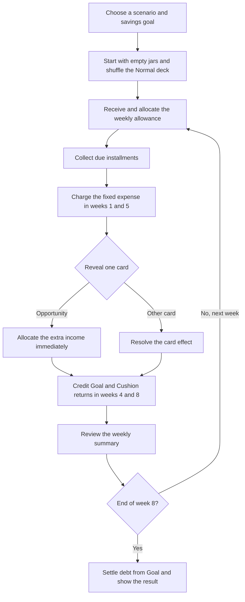
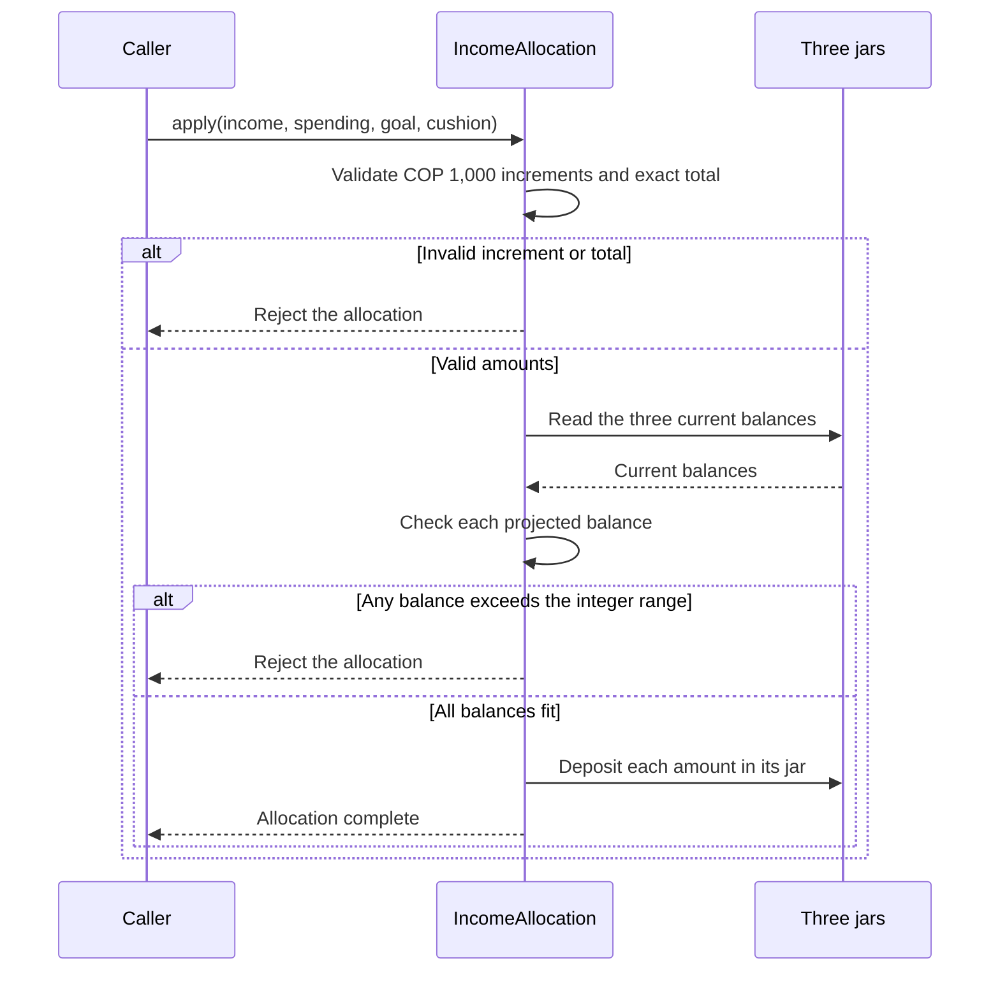

# Mis Lucas

Mis Lucas is an educational financial management game for teenagers aged 12 to 16. During a single-player, eight-week game, the player allocates fictional weekly allowances among three jars, responds to expenses and opportunities, and works toward a savings goal. Amounts are simulated in Colombian pesos.

The game is developed for the Programming Paradigms course at Politécnico Grancolombiano. The second submission covers the object-oriented model, business rules, JUnit tests, and generated Javadoc. The JavaFX desktop interface belongs to the third submission.

## Implementation reference

- [Documentation guide](docs/README.md): scope and reading order.
- [Game, actor, and flow](docs/game.md): player actions and system behavior.
- [Business rules](docs/rules.md): amounts, weekly sequence, credit, and outcome.
- [Proposed model](docs/model.md): class responsibilities and boundaries.
- [Mis Lucas GitHub Project](https://github.com/users/camarinb2096/projects/1): team tasks and progress.

The documented rules are the reference for implementing and testing the model. Any rule change should update `docs/rules.md` and its related tests.

## Stack and current submission

Java 21, Maven, and JUnit 5. The game logic must run and be testable without JavaFX. The academic submission window is **November 21–24, 2026**.

## Architecture

Mis Lucas uses a single Maven module. The second submission implements the model in `org.mislucas.model`, with subpackages for configuration, game state, events, rules, and results. The third submission will complete the Model–View–Controller (MVC) structure with JavaFX. Controllers will pass player actions to the model, and views will display the resulting state and feedback. The model owns the game rules and can be tested independently of JavaFX. See the [model design](docs/model.md) for package responsibilities.

## Game diagrams

### Game flow

The game design covers setup, eight weekly turns, and the final result. The [business rules](docs/rules.md) specify payment order, credit, returns, and scoring.



### Income allocation sequence

`IncomeAllocation` implements the same allocation rule for the weekly allowance and opportunity income. Each amount uses whole pesos, and all three jar balances stay unchanged if validation fails.



## Build and verification

Install JDK 21 and Maven 3.6.3 or newer, and ensure `JAVA_HOME` points to the JDK. Check the active versions with `java -version` and `mvn -version`. Maven downloads the project dependencies and plugins on the first build.

```sh
mvn test             # Compile and run the JUnit 5 tests
mvn clean test       # Repeat the verification from a clean build
mvn javadoc:javadoc  # Generate documentation in target/site/apidocs
```

Production code belongs in `src/main/java` and tests in `src/test/java`.
